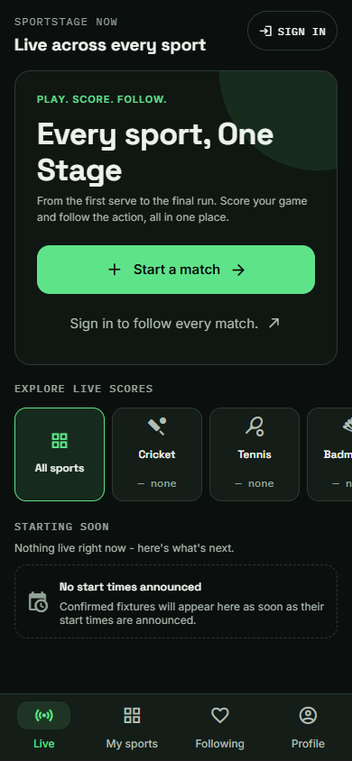
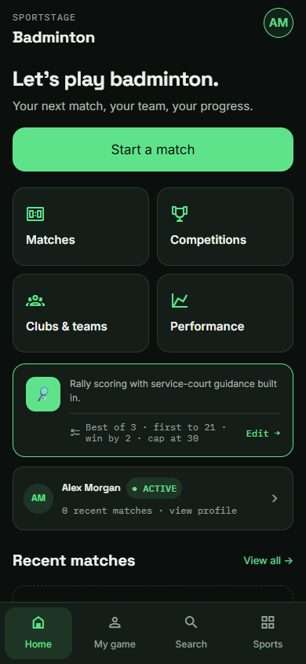
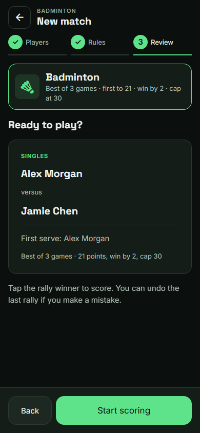
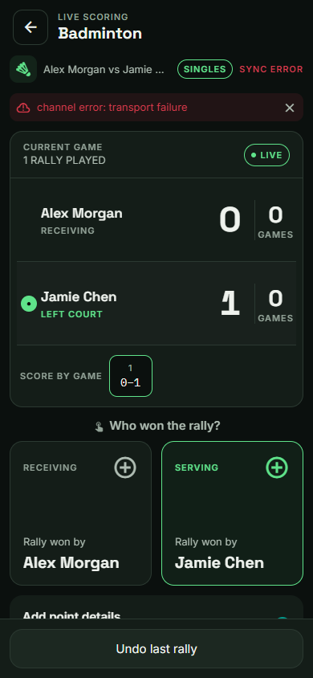
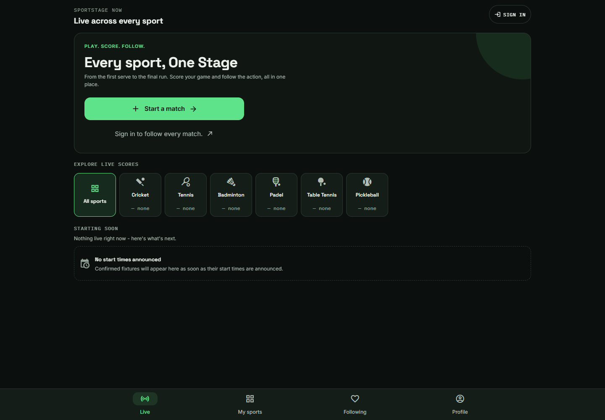

# SportStage UX review and redesign

Implemented September 22, 2026. Direction: a dark, high-contrast sports interface with green primary actions, readable supporting text, and consistent navigation.

## Review findings and changes

| Finding | Implemented change |
| --- | --- |
| The first screen emphasized watching; creating a match required finding a sport app. | A shared **Start a match** launcher on live discovery and My sports. Guests retain their selected match setup destination through sign-in. Unconnected sports lead to account management with an explanation. |
| Global destinations and sport switching were buried in profile drawers. | Persistent Live / My sports / Following / Profile navigation on the global screens; consistent Home / My game / Search / Sports navigation inside sports. |
| Sport tiles mixed navigation and filtering in the same small target. | Each discovery tile now filters the feed, with a visible All sports reset. Sport navigation lives in My sports. |
| Small, low-contrast labels and unbounded desktop layouts made information hard to scan. | Updated shared surface, contrast, typography, button accessibility, touch targets, and centered content width. Increased supporting text sizes on discovery, sport homes, and the launcher. |
| Racquet match setup presented players, serving, and every rule simultaneously. | Players → Rules → Review, with fixed bottom actions, inline validation, player search feedback/retry, named first-server choices, and a collapsed editable rules summary. |
| Cricket setup actions disappeared below long player lists. | Fixed bottom actions, descriptive next-step labels, and a progress indicator, retaining the existing teams / players / toss / review flow. |
| Recording each rally required a second interaction. | Quick scoring records a generic rally winner with one tap; an explicit Add point details switch retains detailed entry. The button says rally winner because a rally does not always award a point in side-out scoring. |
| Saving a point briefly replaced the scoring controls with spectator UI. | Scoring authorization and submission state are separate. Controls stay visible and are disabled during saving; a synchronous guard prevents duplicate submissions. |
| Undo was below the fold on small phones. | Undo stays in a fixed bottom bar. Compact round history leaves more room for named rally controls. |
| Match lists had no search or status filter; failed requests looked like empty accounts. | Player/team search, All / In progress / Finished filters, readable score cards, and distinct loading, error/retry, and empty states. Sport homes provide direct access to matches, competitions, clubs, and performance. |

## Scope and behavior

The redesign uses the existing Expo routes and shared React Native components. Shared visual foundations apply throughout the application. The largest layout changes are in discovery, sport selection, sport homes, match history, setup, and racquet scoring; specialized tournament, club, profile, and cricket scoring tools retain their existing workflows.

Existing scoring engines, tournament logic, access checks, release flags, database APIs, and migrations are retained. Match creation and scoring still use the existing authorized server commands. No production accounts or matches were modified during verification.

## Validation

- `npm run build:check`: lint, strict TypeScript, 485 tests, environment checks, architecture checks, and Expo web export.
- Browser checks in headless Edge at 390 × 844, 320 × 740, and 1440 × 1000.
- Guest flow: sport selection → sign-in with the selected sport’s return route; global navigation and overflow checks.
- Mocked signed-in flow: My sports → sport home → choose players → rules → review → start scoring.
- Mocked scoring checks: quick rally, rapid repeated tap protection, undo, detailed smash winner, and recovery after a failed save. Requests are intercepted; this validates the UI integration rather than production database authorization or realtime delivery.
- Physical-device interaction, keyboard behavior, screen-reader behavior, and real multi-device scoring still need device-level acceptance testing.

## Screenshots

Screenshots use mocked account/match data; names and results are illustrative.

| Live discovery | Sport home |
| --- | --- |
|  |  |

| Match review | Live scoring |
| --- | --- |
|  |  |

